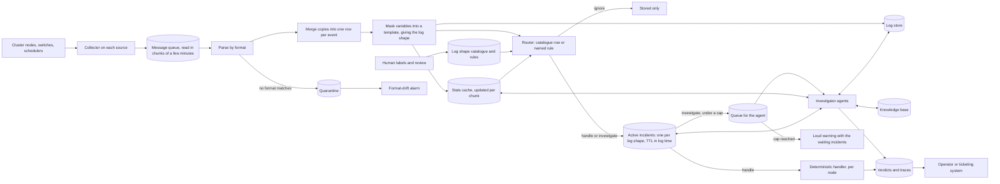

# Step 5: report, README, ingestion diagram

Read first: `AGENTS.md`, [00_overview.md](00_overview.md), all of [docs/lab_notes.md](../lab_notes.md).

Budget: 2.5 hours.

## Goal

A report that a Mave engineer can read in fifteen minutes and that shows what was built, how well it works, how that was measured, and what was learned. A README that takes a stranger from a fresh clone to a verdict.

## Who reads the report

Engineers and researchers at Mave who build agents for security operations. They know LLM agents and evaluation well. They do not know this dataset, and they have not seen the repository. They are judging design reasoning and rigour, and whether Aviv, who is new to agents, learned quickly.

So: lead with what was built and the main results. Give reasons for decisions, not only the decisions. State limits plainly; a small honest number is worth more to this reader than a large vague one.

## Before you start

- Step 4 is done: the results table, the holdout row and the cost numbers are in files, and `notebooks/06_results.ipynb` reproduces them.
- `docs/lab_notes.md` has a decision log and dated notes from every step.

## Who does what

The report is Aviv's and must sound like him. You draft section by section from the lab notes and the result files; he edits. Do not write a claim that is not backed by a file or a lab note. If a section has no material behind it, tell him instead of filling it.

## The report: `docs/report.md`

Six to eight pages.

| # | Section | Content | Material |
|---|---|---|---|
| 1 | Summary | What was built, three headline numbers with counts, what comes next. Half a page | Results table |
| 2 | Understanding the problem | No error label exists: the `flag` finding and merging copies into one row per event. Identifying the cluster from its vocabulary. The problem categories. New log shapes keep arriving | Step 1 notes, `notebooks/03_flag_column_analysis.ipynb`, novelty plot |
| 3 | Design | The pipeline picture. The code-or-LLM table. Routing by catalogue and rules, the handler, and incidents as one log shape while active. The future-proofing table, with the three small demonstrations from Step 2C | Overview sections 4 and 5.5, decisions D17 to D21, Step 2 notes |
| 4 | Data ingestion in production | The diagram below and one paragraph mapping each box to its miniature in the repo. The stats cache updated per chunk is stated as a design principle, with what was built of it | This brief, decision D18 |
| 5 | The agent | The loop, the tools, the verdict schema, the validator. One real trace walked through step by step | A trace from `runs/eval/` |
| 6 | Evaluation | The golden incidents and how hindsight produced the labels. Code metrics. The judge, how it was calibrated, its agreement numbers. What the sample size allows and does not allow | Step 3 notes, `judge_agreement.csv` |
| 7 | Experiments | E1 to E4, and E6 and E7 if they were run, each with hypothesis, table, interpretation. Dev and holdout side by side | Step 4 notes, results table |
| 8 | Cost and latency | Measured per incident, projected per day. What the active incidents and the handler save, what the cap costs in lag (E7), and the saving that reuse and model routing would give | Step 4, `runs/eval/e7_cost.csv` |
| 9 | What I learned | Five to seven specific lessons | Lab notes Part 2 |
| 10 | Limitations and next steps | See below | Decision log |

### Section 9, "What I learned"

This is the section Aviv cares about most. Each lesson is tied to something that actually happened, in the form: what I expected, what I saw, what I changed. For example: "the model cited a log id that did not exist, so I added a validator, which then fired on N of M first answers". Take them from Part 2 of the lab notes. A lesson with no event behind it is left out.

### Section 10, limitations and next steps

Limitations to state, from the change of 2026-10-11 (D23): the agent investigates one log at a time with no routing and no incidents, so its cost follows the number of logs (about 6,000 input tokens per call, up to 8 rounds) and it was run on chosen logs only; the agent's view stops at the time of its log and does not move while it works, unlike a production system where logs keep arriving; the tools are six fixed general ones, where a deployment would list its own tools in a config, some built in and some supplied by the user; the judge sees only the trajectory, so it checks that the work holds up and not that the verdict agrees with a human; the code check of evidence only tells whether a line names an id the agent was shown.

Limitations to state: the knowledge base is partly written by us, so the evaluation measures faithful use of it and not real-world correctness; the golden set is small and leans toward clear-cut cases; the judge's agreement has wide uncertainty; an incident holds one log shape, so a cascade across log shapes is several incidents and unrelated nodes can share one; only a few dozen log shapes are labelled, one has a rule and one a handler, so routing by rules is shown, not proven at scale; the agent starts when an incident opens, on its least informative lines; stats in the repository are SQL scans, and the cache that production needs is described and, if task 1.9 was done, built only in miniature; ingestion is one chunk at a time.

Next steps, each tied to something measured: merging incidents by rule or by the agent, starting from the incidents the agent marked as resolved by another; a settle time and updates during a run, if they were not built, judged by E7's cost against lag; parallel ingestion with the stats cache ordered across workers; fine-tune a small classifier on the catalogue labels to replace the log shape LLM; a second agent that verifies the first one's answer (if E6 was run, its result goes in the experiments section, and this item names what a fuller verifier would add); retrieval over full vendor manuals; an online template miner such as Drain3 in place of hand-written masks; a feedback loop that turns operator corrections into new golden incidents and runbook edits; reuse of verdicts across incidents of the same log shape, with its own evaluation.

### The decision log in the report

Part 1 of the lab notes is not copied in. Its content appears where each decision is used: the "why" line in the design sections, the "what it costs" line in limitations. Aviv keeps the log itself for the interview.

## The ingestion diagram

The assignment asks for a diagram, not an implementation. A draft to refine with Aviv:

The paragraph under it says, for each box, what plays that role in the repository: the replay script stands in for the collector and the queue and delivers 5-minute chunks in time order, SQLite for the log store, SQL range queries for the stats cache unless task 1.9 built it, an in-memory table for the active incidents, the `quarantine` table for the quarantine, and so on. It also says what a real deployment adds that the miniature does not have: ingestion in parallel with the cache kept in order across workers, ordering across sources, retention, and a store built for time-range queries at volume.

## The README

Replace the current README, which only repeats the assignment text. Sections, in order:

1. **What this is**, in three sentences, with a link to the report.
2. **Requirements**: the Python version, `pip install -r requirements.txt`.
3. **Key**: `NVIDIA_API_KEY` in `.env`, and which commands work without a key because their LLM responses are in the committed cache.
4. **Run it**, as exact commands in order, each with one line saying what it prints:
   build the database; load the catalogue; replay the log, which routes every event and opens incidents; investigate one incident; run the evaluation on the dev incidents; score and judge; rebuild the report's tables.
5. **Notebooks**: what does each one contain and the important findings it exemplifies. 
6. **Tests**: the one command that runs all of them (unit, smoke, e2e).
7. **Layout**: the folder table from overview 5.1.

- [ ] Verify the README by following it literally in a fresh clone in a new folder with a new virtual environment. Every command is run, not assumed. Fix what breaks.

## Checks before handing in

- [ ] Every number in the report appears in a file under `runs/eval/` or is produced by `notebooks/06_results.ipynb`.
- [ ] Every percentage has its counts next to it.
- [ ] Every figure has a title that states what it shows and labelled axes.
- [ ] The synthetic nature of the knowledge base is stated in the evaluation section and in limitations.
- [ ] The holdout result is reported as it came out.
- [ ] `requirements.txt` lists everything that is imported.
- [ ] No key in the repository: search the history as well as the working tree.
- [ ] `.gitignore` leaves `runs/eval/` and `runs/llm_cache/` in and `runs/scratch/`, `data/*.log`, `data/*.db` out.
- [ ] The repository is pushed and its link opens for someone who is not logged in as Aviv.

## Done when

A person with the repository link reaches a verdict for one incident by following the README, and the report's tables match the committed result files.

## Suggested commits

Report draft; ingestion diagram; README; fixes from the fresh-clone check.
