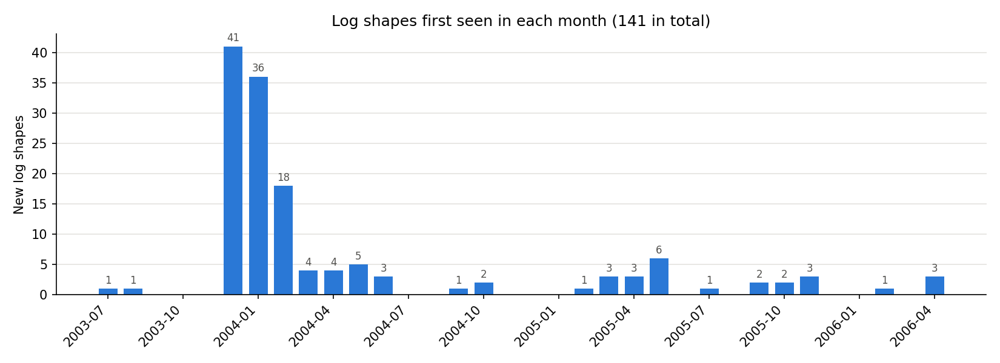
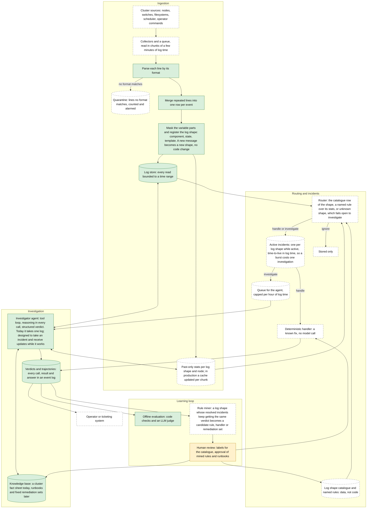
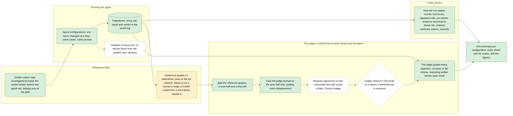
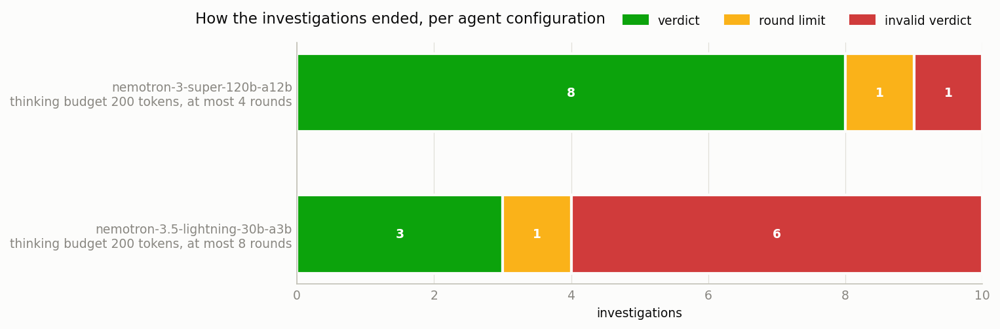
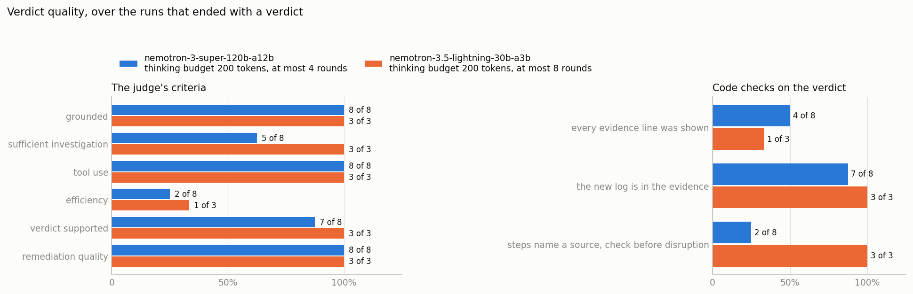
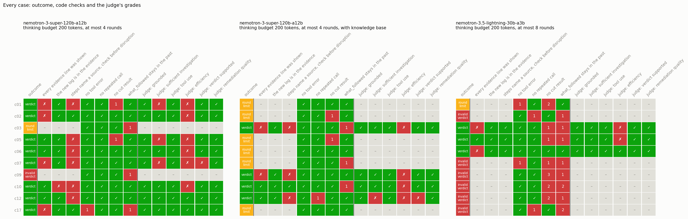
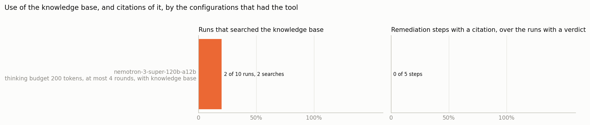
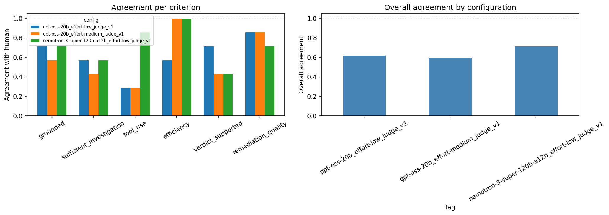
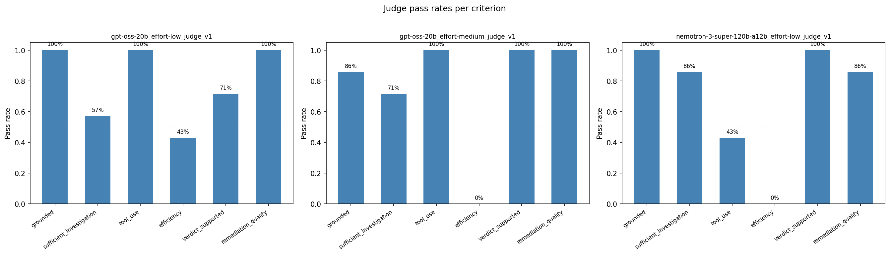
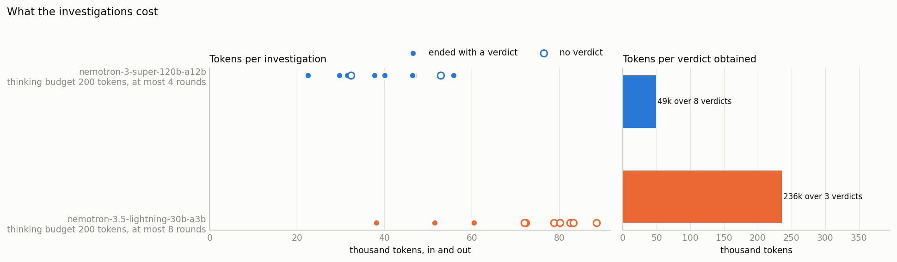

# A problem-resolution system for HPC logs

Aviv Hendler. Home assignment for the Data Scientist role at Mave Security, October 2026.

The repository's [README](README.md) says how to build and run everything. This report says what was built, why, how well it works and what comes next. Every number in it is printed by a script or a notebook in the repository, and Appendix B says which.

## 1. Executive summary

**The task.** Build a system that reads the logs of a high-performance computing cluster, finds the errors, and recommends specific remediation steps backed by citations and reasons. Design it so that new log formats and new recommendations need no code change. Keep cost and latency realistic. The data is a public set of 433,490 log lines from a cluster at Los Alamos, with no labels and no documentation of what the messages mean.

**What I built,** in about four working days. A log store that parses the file into SQLite, merges repeated lines into one row per event, and reduces every message to a *log shape* (component, state, and the message with its variable parts masked), so that a message never seen before becomes a new shape on its own. An investigator agent that takes one log, sees nothing written after it, optionally calls six read-only tools over the store and one over a knowledge base, and returns a structured verdict: actionable, benign or insufficient evidence, with severity, evidence lines it really saw, and remediation steps with a risk mark. An event log that records every model call, tool call and answer, so that any run can be replayed without an API key. And an evaluation that scores every saved trajectory with deterministic code checks and an LLM judge of six criteria, and draws the figures of this report. Before any of that, I investigated one log of each of the 17 most common shapes by hand; the ten I was sure about are the golden cases the agent is measured on.

**Main results.** The agent was run on the ten cases under three configurations, thirty trajectories in all (`runs/eval/summary.csv`). Under several configurations, the agent's performance was not good, on all kinds of measures we looked at. The main model, Nemotron 3 Super 120B with four rounds, reached a verdict on 8 of 10 cases at about 49k tokens per verdict, and on the eight it agreed with my own reading of whether action is needed on all but one borderline case. A model four times smaller, given eight rounds, reached a verdict on 3 of 10 and spent 236k tokens per verdict, because it kept sending its answer in the wrong shape. Giving the main model a knowledge-search tool without changing its prompt cut the verdicts from 8 to 4, and no step cited a passage. The code checks caught what the judge let through: the judge passed every verdict on groundedness, while the code found an evidence line that names nothing the agent was shown in 8 of 15 verdicts.

**What is missing, by design.** The routing layer that would make the agent's cost follow the number of distinct problems instead of the number of logs: a catalogue of log shapes, named rules, deterministic handlers for known fixes, incidents with a time-to-live, and a replay of the stream. It is designed in detail in `docs/plan/`, it is the part the assignment asked to sketch rather than implement, and I spent the time on the agent and on measuring it instead. The judge's reference grades came from a frontier model and not from a person, so the judge is not calibrated yet; the infrastructure for calibrating it is.

**The five next steps,** in order. Build routing and incidents, which turn the cost from per log to per problem. Have an HPC operator label a stratified sample of cases and grade trajectories, and calibrate the judge on the held-out half. Repeat every experiment arm and measure how the length of the context changes what the agent does. Mine resolved incidents for rules, handlers and fixed remediation sets, under human review, so that more of the system becomes deterministic as it runs. Mask what leaves the cluster and gate disruptive actions before any deployment.

## 2. Background: the data and the domain

### 2.1 The dataset

The file is `HPC.log` from Loghub: 433,490 lines written between 2003-07-31 and 2006-04-30, about 33 months (`notebooks/01_initial_EDA.ipynb`). Each line has a record counter, a source, a component, a state, an epoch timestamp, an undocumented column called `flag`, and a message. There is no error label, no severity, and no description of the columns. Loghub lists no labels for this dataset.

Three findings about the columns shaped the log store.

**The record counter is not an event id.** It was restarted several times, so the same value sits on unrelated events: 325,352 distinct values over 411,483 distinct events, and 78,572 of the values appear on more than one event (`notebooks/01_initial_EDA.ipynb`). Two events that share a value are at least 18 days apart. Repeats therefore have to be found by comparing the other fields.

**The `flag` column is not an error label.** It takes the values 1 (418,546 rows), 0 (11,779) and -1 (3,165). Rows with 0 or -1 are almost always identical copies of another row, and among the copies of one event the flag only ever moves from 0 to 1 in file order, never back (`notebooks/03_flag_column_analysis.ipynb`). It looks like a state of the record that changes once, and it says nothing about severity: it appears on routine state reports such as `running` and `configured out`. I do not know what it means, and the system does not use it.

**One event is reported several times.** Comparing source, component, state, time and message, 411,483 of the 433,490 lines are distinct events and 22,007 are repeats. The store keeps one row per event: a repeated line updates the row and increments a counter, so the store is idempotent under at-least-once delivery, which a stream needs (decision D15 in `docs/lab_notes.md`).

Two more facts matter for everything after. The source column is not always a node: only 158,466 of the events come from the 256 compute nodes, and the rest come from 16 interconnect switch modules, 8 ethernet switches, 8 domains, 8 terminal servers, a management server, a scheduler partition, and 2,078 operator commands, each of which is a source whose message names the nodes it targets. And the file is not in time order: its first line is from April 2006, so a replay has to sort by timestamp. A typical day with logs has 236 events and the busiest has 12,942.

### 2.2 What the cluster is

No documentation comes with the data, so I identified the system from the vocabulary of its messages and from public sources, listed with how much of each could actually be read in `kb/sources.md`. Los Alamos' own failure-data page lists the release, "System 20 usage event info", with exactly 433,490 records and nodes 0 to 255. The terms in the logs (SRM, RIS boot, LMF, NIFF, file domains, partitions, switch modules and link errors) match the contents page of the Compaq AlphaServer SC RMS Reference Manual: a supercomputer built from Alpha servers, joined by a Quadrics interconnect, managed by RMS and running Tru64 UNIX. Only the first twenty pages of that manual could be read, so it confirms which concepts exist and not what each status means. Terms such as NIFF and LMF were confirmed from Tru64 manual pages. What `gige`, `psu`, the `boot_cmd` family and the cluster filesystem messages mean remains a reading of their names.

What the logs themselves reveal about the layout is written in `kb/cluster_facts.md`, every statement marked `[data]`, `[source]` or `[guess]`, and every count printed by `notebooks/05_cluster_facts.ipynb`. The 256 nodes sit in 8 domains of 32: all 652 operator commands that name one domain and one node agree that `node-D<k>` holds nodes `32k` to `32k+31`. Filesystem messages are reported by a domain, never by a node, and the serving node they name is inside that domain in all 7,982 such logs. The 256 storage file domains are served by 64 nodes only, four each, and the name of a storage file domain gives its serving node in 668 of 670 logs: `storage612` means `node-20`. There are 16 switch modules of two kinds, and broadcast errors come almost only from two of them. These facts turn a name in a log into a place in the cluster, which is what an investigator needs most.

### 2.3 Log shapes, and why new ones never stop arriving

A **log shape** is a component, a state, and a **template**: the message with its variable parts replaced by placeholders. The masks (`logstore/templating.py`) replace quoted names, hexadecimal values, node names and sets of nodes, numbers, and the asterisks the firmware prints where a number could not be read; a list of nodes or numbers becomes one item, so a command that failed on one node and one that failed on twenty share a template. The same masked text under another component or state is another shape, because it can mean something else and take another label (D16).

The masks give 141 log shapes over the whole file. I checked them against Loghub's hand-annotated 2,000-line sample (`notebooks/02_loghub_template_check.ipynb`): they never merge two different messages into one template, which is the error that matters because a wrong merge could hide a problem under a harmless label, with one exception made on purpose, the fan report with and without a missing reading. Grouping agrees with the annotators on 93.1% of the sample's lines; Loghub's benchmark lists the Drain parser at 88.7% on the same sample. The masks were written looking at this data, so this shows they are sound here, not that they would generalise to another format.

Shapes keep appearing. Most arrive when the logging gets going, 41, 36 and 18 in December 2003, January and February 2004, but 21 of the 34 months bring at least one new shape, 28 shapes are first seen more than a year after the first log, every quarter after that first year brings between 1 and 9, and the last three arrive in the final month of the data (`notebooks/04_log_shape_novelty.ipynb`). One text was replaced overnight: `Linkerror event interval expired` was last seen on 2005-05-18 and `link errors remain current` first appeared the next day, in the same component and state. A label does not carry from one to the other by itself. This is the measured reason behind the design rule that everything that changes over time lives in data, and that an unknown shape goes to the agent.



### 2.4 What counts as an error here

Nothing in the data says. A word like "error" is not a label: `Link ok` is filed under the state `error`, and `PSU status ( on off )` contains no error word. A line has to be judged by what is around it: what the same source logged before, how many sources show the same thing in the same minutes, whether an operator was working (commands are logged under the components `action`, `boot_cmd` and `shutdown_cmd`, and planned work writes the same error lines as a failure), and what followed the same pattern in the past.

The hand investigations (section 5.2) showed how much of this is context rather than text. 85% of the `configured out` lines in the 30 days looked at follow a `not responding` on the same node within 5 minutes: the line is the system's reaction, not the problem. A gige device wrote a temperature `warning` only when its level changed, and sat in `warning` for 89% of a day, so its lines look like brief alerts and are a chronic state. The fan report of one switch is one shape whether it holds six speeds or a missing one, so its severity has to be read from the value.

Hindsight is the only source of labels without a domain expert: a recovery message after a log means it cleared, an operator's boot command means a human acted. I used it to decide my verdicts after writing them, and the agent never sees it, because in real use that information does not exist yet. An operator action after a log is correlation and not proof of cause, and the report says so wherever it leans on it.

## 3. Goal and metrics

### 3.1 What the system has to produce

The unit of output is a verdict on one log, in a fixed structure that a human operator and the evaluation read alike. It says whether the log is `actionable`, `benign` or `insufficient_evidence`, and for a problem its severity, category and scope. It gives a summary and a root cause, marked as a hypothesis when it is one. It quotes the evidence lines the conclusion rests on, each copied from something the agent actually saw. It lists remediation steps, each one concrete action naming the node or device, with its reason, its risk (`safe` or `disruptive`) and a citation into the knowledge base when one was retrieved. And it states a confidence. The third verdict exists so that the system can say "a human has to look at this" instead of guessing.

### 3.2 What a problem-resolution system should be measured on

Before choosing what to measure here, I looked at how incident-management and site-reliability practice measures the thing this system is meant to improve. The metrics below are the goals of the full system. Most of them need a deployment that routes a live stream, groups logs into incidents and acts, which this project does not have yet; section 3.4 says which ones it does measure.

**Time.** The standard lifecycle metrics are the time to detect a problem (MTTD), the time until someone acknowledges it (MTTA), the time until it is resolved or the service is recovered (MTTR, whose "R" is used for respond, repair, recover and resolve by different authors, so a definition has to say which), and the time between failures (MTBF). An automated investigator owns the stretch from detection to diagnosis, so its own numbers are the time from the first log of an incident to a verdict, and the time to the root cause. One caution from SRE practice carries over: averages of these times are noisy at the incident volumes of a single cluster, so they serve to improve the system and not to rank it month by month.

**Noise.** The volume of alerts an operator sees, the compression ratio from raw logs to incidents, the share of incidents correctly filed as needing no action, and above all the problems that were missed. In operations as in security a missed problem costs more than a wasted investigation, so recall on "needs attention" matters more than precision.

**Automation.** The share of incidents closed with no human action (the auto-remediation rate), which only means something next to the share that were reopened and the share where the automated action was wrong. The escalation rate is its complement; in this system `insufficient_evidence` is the escalation.

**Cost and safety.** Cost per incident and per day, per cluster. Whether any disruptive action is gated by a check or an approval. Whether sensitive content leaves the cluster.

### 3.3 What an investigating agent should be measured on

The agent-evaluation literature of the last two years separates the outcome of a run from the path that reached it, and measures the measuring instrument itself.

**Outcome.** Was the verdict right, against a reference written independently of the agent. This is the gate; everything else explains it.

**Process.** Whether each tool call had a purpose, picked the right tool, passed sensible arguments and respected what depends on what; how many steps it took against what the task needed; repeated calls, calls whose results were cut and treated as complete, errors left unfixed. Benchmarks such as TRAJECT-Bench report these trajectory diagnostics beside the final accuracy, and the practical guides recommend grading them with deterministic checks where a rule can be written, and reading transcripts to validate whatever grader is used.

**Groundedness.** Every fact in the answer traceable to something the agent retrieved; every quoted line really shown; every citation really retrieved. Invented ids are a code check; unsupported claims need a judge.

**Validity.** The share of runs that end with an answer in the required structure at all. An agent that produces a brilliant verdict in a shape no program can read has failed.

**Consistency.** The same input can give different outputs. τ-bench proposed pass^k, the chance that all of k repeated runs succeed, next to pass@k, the chance that at least one does; the first falls quickly as k grows for current agents. One run per configuration is one sample, and a difference of a case or two between two single runs is not a finding.

**Cost and latency.** Tokens in and out, calls, seconds, per run and per answer obtained; a run that fails is paid for too.

**The grader.** An LLM used as a judge is a classifier and has to be measured like one: agreement with human labels on a held-out set, with chance-corrected agreement (Cohen's kappa) and the recall of failures, not raw agreement alone. Judges have known biases, towards the first of two answers, towards longer answers, and towards answers from their own model family, so the judge should come from another family than the agent, its prompt and model pinned, and humans kept in the loop to define what "good" means. The practical guides also separate a capability suite, hard cases the agent does not yet pass, from a regression suite that should stay near full marks.

### 3.4 What this project measures

| Goal | Measured here by | Where |
|---|---|---|
| Verdict right against a reference | Read by hand against the hand-investigated verdicts; no automated check, because the judge is given no expected answer | Section 5.2 |
| Grounded | Judge criterion `grounded`; code check that every evidence line names an id the agent was shown | `evals/score.py`, `prompts/judge_v1.md` |
| Sufficient investigation | Judge criterion | `prompts/judge_v1.md` |
| Tool use and efficiency | Judge criteria `tool_use` and `efficiency`; code counts of tool errors, repeated calls, cut results, rounds, and hindsight ranges that reach into the present | `evals/score.py` |
| Verdict supported by the evidence | Judge criterion | `prompts/judge_v1.md` |
| Remediation an operator can act on | Judge criterion; code check that each step names a source and that a check precedes a disruptive step | `evals/score.py` |
| Citations | Code: steps with a citation, citations that name no retrieved passage | `evals/score.py` |
| Validity | Code: how each run ended (verdict, round limit, invalid verdict) and the kind of schema error | `evals/score.py` |
| Cost and latency | Code: tokens in and out, model seconds, per run and per verdict obtained | `evals/score.py` |
| Consistency across repeats | Not measured: one run per configuration | Section 9 |
| Judge agreement with a reference | Agreement per criterion on the tune half of reference-graded trajectories, three judge configurations | `notebooks/09_judge_calibration.ipynb` |
| Time to verdict, noise, auto-remediation rate, cost per day | Not measurable without routing, incidents and a live stream | Section 10 |

## 4. Approach and system design

### 4.1 Design principles

Eight rules, each with the reason it was adopted. Decisions are numbered as in the decision log, Part 1 of `docs/lab_notes.md`.

1. **Code decides what code can decide; a model is called only where judgment is needed.** Parsing, merging, masking, routing, incident grouping, known fixes and every check on the agent's output are deterministic. The agent is the one stage that reasons over evidence. The evaluation applies the same rule: an LLM judge only where no rule can be written (D7).

2. **The agent's cost should follow the number of distinct problems, not the number of logs** (D1). One failure writes many lines on many sources. A rough keyword pass during planning found about 139,000 error-like events that fall into about 6,700 incidents with about 300 distinct signatures, of which the 20 most common cover 89% (`notebooks/01_initial_EDA.ipynb`; the filter was crude and the numbers are rough). Grouping before calling a model is the whole cost argument, and section 4.3 says how.

3. **Everything that changes over time lives in data, not in code.** A new message becomes a new log shape on sight. The catalogue of routes and the rules are a table and a config file. The knowledge base is a folder of markdown files, indexed when the process starts. Models, round limit and request options are one YAML file; a prompt change is a new file, never an edit. The assignment's "new log templates, formats and recommendations" is answered by this rule.

4. **Unknown fails open** (D3). A log shape nobody has labelled goes to the agent. In operations as in security a missed problem costs more than a wasted investigation, and the novelty plot shows the unknown never stops arriving.

5. **No look-ahead, so that experiments are honest** (D6, D20). Every tool stops at the time of the log under investigation; labels use hindsight and the agent cannot. Its only purpose is to keep the agent from cheating in evaluations and experiments. In a deployed system the agent's view would move as time passes while it works, and the loop would send it updates about logs ingested since it started.

6. **Every step leaves a trace.** Every tool call carries a `reasoning` of one to three sentences; every model reply, tool result, verdict and failure is a row in an event log under one request id; the verdict is a schema that a program can check. An evidence line that names nothing the agent was shown, or a citation of a passage it never retrieved, is recorded rather than silently accepted (D11).

7. **Measure the instrument before trusting it** (D5, D8). Expected answers are written before the agent exists. The judge is tuned on one half of the reference grades and reported on the other. Code checks sit beside the judge so that a reader can see where they disagree.

8. **Bounded by construction** (D22). Every read of the store takes a time range of at most 31 days, so no call an agent can make pulls the whole table. A tool result shows at most 50 rows and says how many it left out. A run has at most four rounds.

### 4.2 The target system

The figure is the system as designed: the ingestion flow the assignment asked to sketch, the routing and incident layer that keeps the agent's cost proportional to the number of distinct problems, the agent, and the loop that turns resolved incidents into deterministic rules. Solid boxes exist in the repository. Dashed boxes are designed and not built. Shaded boxes are human steps.



**Ingestion.** Sources write lines; collectors put them on a queue that is read in chunks of a few minutes of *log time*, the latest timestamp ingested so far, so that every wait and expiry in the system is counted on the logs' own clock and a fast replay behaves as the live stream would. Each line is parsed by its format; a line no format matches goes to a quarantine that is counted and alarmed, which is how a new format is noticed. Repeated lines are merged into one row per event. The message is masked and its log shape registered. Per-shape and per-node counts over the last hour, day, week and month are kept in a cache updated with each chunk, so that a routing decision costs a lookup and never a scan, and never includes the future (D18). In the repository: the parser is one regular expression for the one format in the file, the store is SQLite, the stats are SQL range queries, and `scripts/build_db.py` loads the whole file in one go. The collector, the queue, the quarantine and the stats cache are design.

**Routing and incidents.** For each new event, code reads the catalogue row of its log shape: `ignore` for telemetry, recoveries and operator steps, `handle` for a problem with a known fix, `investigate` for a problem that needs judgment, or the name of a rule that decides from the counts, such as "one link error is ignored, more than three on a node within an hour are investigated". Rules are written from a fixed set of conditions in a config file, so a new rule is data. A shape with no row is investigated, and a small model may propose a row for a human to review (D2, D17). A log routed to `handle` or `investigate` opens an incident for its shape, or joins the one already active; the incident stays active while new logs keep arriving within a time-to-live, and closes after a maximum duration. A thousand lines of one burst cost one investigation (D19). Handlers answer known problems in the verdict's format without a model. Investigations are capped per hour of log time, and incidents over the cap wait in a queue ordered by severity, with a loud warning (D20). None of this is built. It is the part the assignment asked to sketch, I understood it is the core of the cost argument, and I chose to spend the time on the agent and its evaluation, which the assignment asked to build.

**Investigation.** The agent receives a compact starting context, calls tools over the store, the stats and the knowledge base, and submits a verdict that code checks. Built, with one difference from the design: it takes a single log and not an incident, and its view of the logs does not move while it works (D23). The event log of every run is built.

**Learning loop.** Verdicts go to the operator and to the offline evaluation, which is built. They also feed the rule miner, which is design: section 4.3 describes it.

What a real deployment adds that the miniature does not have: ingestion in parallel with the stats cache kept in order across workers, ordering across sources, retention, and a store built for time-range queries at volume.

### 4.3 How the system gets cheaper as it grows

Four mechanisms, in the order they would be built.

**Incident grouping.** A burst is one investigation, not one per line. The time-to-live and the maximum duration are set per severity in config, and the rules for joining and escalating an incident are data that can be extended as new kinds of burst are met. This is the single largest saving and the hardest piece to get right, because the wrong window splits one problem into many or glues unrelated ones together; it was too complex to implement properly in the time, so it is designed and not built.

**The catalogue.** For most log shapes the answer never changes, so it is decided once and stored: at most 141 decisions instead of 411,483. The head of the distribution is short: the 17 most common shapes hold 90.6% of all logs (`notebooks/incidents/00_log_shapes_and_tools.ipynb`), so a few dozen human labels route most of the volume by code, and the long tail goes to the agent, which is what the agent is for (D21).

**The rule miner.** This is the mechanism that makes the share of deterministic handling grow over time, and I consider it the most valuable idea in the design. As resolved incidents accumulate, a log shape whose incidents keep getting the same verdict and the same remediation becomes a candidate: a catalogue row, a rule, a handler, or a fixed set of remediation steps. Candidates are submitted as changes for a human to review, ordered by the criticality of the incident first and then by its frequency, so that review time goes first to accuracy and then to cost. Some candidates need no code at all, only a row in a table of actions per shape. The agent's work is then reserved for what is new and what is ambiguous, and the system gets cheaper and more predictable the longer it runs. The hand investigations already show candidates: the fan report with a missing reading is a hardware ticket every time, a `configured out` that follows a `not responding` is never the problem itself, and a `running` is a recovery.

**Model routing.** Calls that a small model handles as well as the large one go to the small model. Measured here, the small model is not there yet (section 6.1), which is itself a result: it says what fine-tuning or a stricter output format would have to fix first.

### 4.4 How the evaluation was designed

Two instruments, used together: code checks, which are exact and free, for everything a rule can decide; and an LLM judge, calibrated against reference grades before it is trusted, for what needs judgment. Solid boxes exist in the repository. Dashed boxes are designed and not done.



There are two reference datasets because they answer different questions (D5). The golden cases say whether the agent is right: inputs with expected answers, written before any agent existed so that they are not anchored by its output, and valid across agent versions. The reference grades on trajectories say whether the judge is right; they expire with every change to the agent. Every configuration is run on the same cases with the same prompt, one factor changed at a time, and the hypothesis is written in the lab notes before the run.

The code checks run first because they are exact, free and repeatable, and because a check that takes a minute to write catches literal failures that a judge waves through. The judge then grades every trajectory that ended with a verdict on six pass-or-fail criteria in one call, writing its reasoning before each result: grounded, sufficient investigation, tool use, efficiency, verdict supported, remediation quality. It sees the trajectory and the list of tools the agent had, and nothing else: no expected answer, so it judges whether the work holds up on what the trajectory shows. It is a model from another family than the investigator, because judges favour their own family (D12). Pass or fail is faster to label than a scale, forces a decision, and gives agreement numbers that are easy to read.

Calibration follows the rule for any classifier: tune the prompt on one half of the reference grades, reading every disagreement to decide whether the judge, the label or the criterion is wrong, then measure on the untouched other half, and use for conclusions only the criteria whose recall of reference fails clears a threshold set in advance, 70% (D8). What was done: eleven trajectories were reference-graded, seven were used to compare three judge configurations, and the other four are kept untouched for the calibration against human grades. The reference grades were produced by Gemini 2.5 Pro from the judge's exact prompt, because a person grading twenty trajectories did not fit the time; section 6.4 says what that allows and what it does not.

### 4.5 What runs today

One log in, one verdict out, every step recorded, and one command to evaluate everything saved.

```
data/original_dataset/HPC.log
  |  parse, mask, register the log shape, merge repeats     logstore/
  v
data/hpc.db                                                 scripts/build_db.py
  |  one log to investigate: a golden case, or any raw line
  v
starting context: the log, its source's hour before,        agent/context.py
  the same shape across the cluster in that hour
  |
  v
investigator loop, at most 4 rounds                         agent/loop.py
  |  tool calls -> run, send back            agent/tools.py: 6 log tools, +1 knowledge tool
  |  submit_verdict -> checked by schema     agent/schema.py
  |  every event under one request id        agent/trajectory.py -> runs/agent.db
  v
verdict + trajectory
  |
  v  offline
evals/score.py        code checks on every trajectory
agent/judge.py        LLM judge on every trajectory with a verdict
evals/figures.py      five figures -> docs/figures/
```

Around it: a cached LLM client, so that every committed run replays without a key; unit tests that never touch the network and four smoke tests that do; and a CI workflow that runs the unit tests and then the smoke tests on every push. The README lists every command and was verified by running each one.

### 4.6 Main challenges

**Understanding and labelling the domain without an expert.** HPC administration does not follow a simple procedure, and I had never done it. I answered with three things: public sources for what the terms mean, hindsight in the logs for what operators actually did, and a fact sheet that marks every statement as data, source or guess. The cost is in section 9: the cases I could label are the ones I could understand, which biases the sample.

**Evaluating trajectories.** An agent's run has many ways to be good or bad, and a single run is rich enough that holding cases out hurts. The instrument also needs its own measurement, and a human who reads a failure and writes a rule into the prompt against it overfits the test set by hand. The design answers with two reference sets, a tune and test split for the judge, code checks beside it, and hypotheses written before runs.

**Generality across clusters.** Other clusters have other software, other message formats and other common incidents. The masks were written for this data; the log shape mechanism, the catalogue and the knowledge folder are generic; the tools are six general ones, and device-specific helpers that the hand investigations used were deliberately left out of the agent, because in a deployment some tools would come from the user's own software and a config per deployment would list them.

**Cost.** Token use is not predictable in advance and depends on the architecture as much as on the model. I measured it per investigation; projecting it per day needs usage data a deployment would collect (section 6.5).

**Customisation to user preferences.** Operators disagree about what is critical and how to act. The design has a place for this, an actor agent that holds the user's preferences and acts on another agent's analysis, and it is not built.

**Security and privacy.** Logs name hosts, users and paths; an agent that acts can do harm; evidence it gathers can carry injected instructions. Nothing of this is implemented, and section 9 says what must be before any deployment.

**Transparency about limits.** The agent can say `insufficient_evidence`, and a run that ends without a valid verdict is counted as a failure and shown in every figure, not dropped.

## 5. The solution in detail

### 5.1 The log store

`logstore/` holds the parser, the masks, the schema and the queries. One regular expression reads a line into its seven fields; a line that does not match is reported, never dropped silently. The `logs` table has a unique index on source, component, state, time and message: a line that repeats a stored event updates the row to that line and adds one to `n_copies`, so the rule holds across loads and the store is safe under redelivery. A full build of the file takes seconds (`python -m scripts.build_db --rebuild` prints 411,483 logs, 22,007 merged copies, 141 log shapes, 9 unusable timestamps).

Every read takes a start and an end and refuses a range longer than 31 days (D22). There are four reads, and they are exactly the questions an investigation asks: `search`, the logs of a range that pass filters on source, component, state, text and shape, newest first; `count_by`, counts per source, component, shape or hour; `stats`, the log count, source count, first and last time of what `search` would return; and `node_timeline`, one source's history with runs of the same shape collapsed. A fifth read, `shape_history`, gives per-shape counts up to a moment and returns no log. Indexes on time and on shape and time serve them. The store holds nothing else: what only a notebook needs lives in the notebook.

### 5.2 Hand investigations and the golden cases

Before building an agent I investigated one log of each of the 17 most common log shapes by hand, in `notebooks/incidents/`, with the queries above and nothing else. Each notebook follows one rule: every question looks only at the log and what came before it, which is all the agent will have; the verdict comes next; and anything that looks at what happened afterwards is marked as hindsight and used only to check the verdict. The helpers I wrote for these notebooks became the agent's tools, so an investigation by hand and one by the agent read the same data in the same way, and a difference between them is a difference of judgment (D23). Thirteen of the seventeen reached a verdict; the ten I was sure about are the golden cases in `labeling/golden_cases.yaml`, each pinned by its raw line so that a rebuilt database gives the same log.

| Case | The log | My verdict, from the notebook | The agent's verdict, main model without the knowledge tool |
|---|---|---|---|
| c01 | `Linkerror event interval expired`, a switch module, 2004-03-18 | The first minute of an outage of most of the cluster. Critical; the line is a symptom | actionable, high, interconnect, several sources |
| c02 | `ambient=26`, node-77 | Normal; the reading a node writes after boot | benign, telemetry |
| c03 | gige3 temperature `warning` | Low severity; this device lives in `warning`; warn once | no verdict, ended at the round limit |
| c05 | Fan speeds with a missing reading, one switch module | Low severity; a hardware ticket for fan 4, nothing shows the switch running hot | actionable, medium, hardware, single source |
| c06 | node-194 `running` | A recovery that ends a nine-hour outage; no action | benign, operations, cluster-wide |
| c07 | node-240 `configured out` | The system's reaction to `not responding`; the real problem is 29 neighbouring nodes down, serious | actionable, high, node state, cluster-wide |
| c09 | node-98 `boot (command 4220)` | No action; the line is the operator's fix for a cluster-wide outage | no verdict, invalid answer |
| c10 | node-94 `wait (command 2616)` | No action; the second step of a boot after a planned cluster-wide shutdown | benign, operations, cluster-wide |
| c12 | node-221 `not responding` | Critical; an outage of most of the cluster; one alarm, not 256 | actionable, critical, interconnect, cluster-wide |
| c17 | node-200, interface `alt0` unavailable | A warning; a busy interface that drops and returns within seconds, no crash | benign, telemetry, several sources, medium confidence |

My verdicts come from the notebooks' verdict cells, summarised in `notebooks/incidents/README.md`; the agent's come from `runs/eval/trajectory_scores.csv`. Reading the table: on the eight cases with a verdict, the agent and I agree on whether action is needed on all but c17, where I would warn and it called the line benign with medium confidence. Severity is one step apart on c01 and c05. On c12 the agent put the cause on the interconnect link errors, which began at 12:14:21, where I had put it on the partition going blocked at 12:15:00; its reading of the order is the better one.

What the investigations taught, beyond the verdicts: a default that truncates quietly misleads, so every tool result now says what it left out; looking ahead is the easy mistake, so every query is bounded at the log's time; and some shapes can only be judged by a value or by time spent, which is why the agent gets the raw lines and not only the shape.

### 5.3 The investigator agent

**The loop** (`agent/loop.py`) is about a hundred lines on the OpenAI client pointed at NVIDIA's endpoint. I wrote it rather than adopt a framework so that the list of messages is the trajectory and I can explain every branch (D10). Each round the model is called once. It answers with tool calls, which are run and sent back together with a notice of the round it is in, or with `submit_verdict`, which ends the run. A reply with no tool call gets a reminder. A verdict that fails the schema gets its errors back once. Tool calls on the last round end the run as a failure, recorded as such. A model error ends it, recorded as such. At most four rounds; the prompt states the same number and tells the model to ask for several facts in one round rather than one per round.

**The starting context** (`agent/context.py`) is the same three things for every log: the new log with its shape; the timeline of its source for the hour before, with runs of the same shape collapsed; and the same shape over the whole cluster for the hour before, with counts per source and the newest twenty lines. Both windows end at the log's own time. On the first round of the model-selection runs this came to 5,697 input tokens, most of it the system prompt and the tool schemas (`notebooks/06_model_selection.ipynb`).

**The tools** (`agent/tools.py`) are the hand investigations' helpers with a visible-time limit and a row cap.

| Tool | What it returns |
|---|---|
| `search_logs` | The logs of a range that pass the filters, each with its id and shape id; at most 50, the newest, and a line saying how many were left out |
| `node_timeline` | One source's history in a range, runs of the same shape collapsed into one line with a count |
| `log_shapes_between` | Every shape seen in a range, in order of first appearance, with counts: what the whole cluster did around a moment |
| `count_logs` | Counts per source, component or hour: when something happened before, a burst against a trickle |
| `find_log_shapes` | The shapes seen so far that match a text, component or state, with their history: which messages exist |
| `what_followed` | Hindsight on past occurrences of a shape: what the same source logged shortly after each, and how soon. For the new log itself nothing has followed yet, and the prompt says so |
| `search_knowledge` | Passages of the knowledge base matching a query, present only when knowledge is on |

Every call has a required `reasoning`. Every result row carries an id, and the tool returns the ids it showed, which is how evidence is checked. A call with bad arguments returns a line starting with `error:` and the run continues; a call asking for anything after the visible time is cut at it. The notebooks call the same functions with no limit.

**The verdict** (`agent/schema.py`) is a pydantic model with extra fields forbidden, so a field the model invents is an error and not something dropped silently. An actionable verdict needs a severity and at least one step; a benign one has severity `none`. Two checks run on every accepted verdict and are recorded, not enforced (D11): the evidence lines that name no log id, shape id or passage id the agent was shown, and the citations that name no passage it retrieved. The first is a signal and not a proof, since a line that names a shown id can still misquote it; whether the quote is faithful is the judge's question.

**The record** (`agent/trajectory.py`): every event of a run is a row in `runs/agent.db` under one request id, with tokens and latency on each model reply. `Trajectory(request_id)` reads them back as the text a person or the judge reads, the verdict, the failures and the totals.

**The LLM client** (`agent/llm.py`) is the single entry point for every call: a disk cache keyed on a hash of the whole request, so that a committed run replays without a key and a measurement is known to be stale as soon as any part of the request changes; spacing to stay under 30 requests a minute on the free tier; two retries and a 45-second timeout. Request options per role, such as the investigator's thinking budget, are in `config/models.yaml`.

**Models.** Three candidates from NVIDIA's live catalogue were checked in `notebooks/06_model_selection.ipynb`: a well-formed tool call, a two-step chain, a forced tool choice, and one call as judge on a trajectory that is plainly bad. All three pass the first two checks; gpt-oss-20b does not obey a forced choice; the 30B Nemotron timed out as judge. The investigator is Nemotron 3 Super 120B and the judge is gpt-oss-20b, a different family, the only one available that answered the judge check in a valid form (D12). Both models think before they answer, in text that is never returned, and that thinking was most of the latency: on the first round of one investigation, five times each, the median was 34.7 seconds with full thinking, 11.5 with a budget of 500 tokens, 7.1 with 200 and 2.5 with none. Full thinking also asked for a median of 5 tools in one round against 1 for the other settings. The investigator already writes a reasoning in every call, so its hidden thinking is capped at 200 tokens.

**The prompt** (`prompts/investigator_v1.md`) says who the model is and who reads its answer; what happens on such a cluster, in five patterns (a node that stops responding and everything that complains after it, overheating, another administrator working, noise, one source against the whole cluster); how the logs and the shapes are named; what the starting context holds; to ask first whether it has enough evidence and to submit at once if it does; to ask for several facts in one round; how to use tools without wasting rows or rounds; six questions to settle, including operator commands and hindsight on earlier occurrences; and the meaning of every field of the verdict. The judge's prompt mirrors it.

### 5.4 The knowledge base

The knowledge base is one file, `kb/cluster_facts.md`: what is known about the cluster, with every statement marked `[data]` with its count in `notebooks/05_cluster_facts.ipynb`, `[source]` with the document in `kb/sources.md`, or `[guess]`. There are no runbooks. The vendor manual's body could not be read, and a runbook written without it would have been my invention presented as guidance; a fact sheet that turns `storage612` into `node-20` is worth more to an investigator than advice it cannot check.

`agent/knowledge.py` loads every file in the folder that has a front-matter header, splits it at its headings into passages, and ranks passages against a query with BM25, a lexical ranking by shared words weighted by rarity. A passage id is the file id and the heading, and that id is what a citation names. The index is built when the process starts, so a new file is picked up with no code change. Semantic search was deliberately not used: a handful of documents does not need it, and lexical search is easy to explain and to test. Its cost is that a paraphrase sharing no word with a passage is missed.

The agent reaches it through one more tool, `search_knowledge`, registered only when `knowledge` is on in the config. The system prompt does not change: the tool's description tells the agent that the knowledge exists and how to cite it, so that turning knowledge on changes exactly one thing in the comparison. A citation names a passage id in a step's `citation` field or at the start of an evidence line, and code records any citation of a passage that was not retrieved. A smoke test builds the index, finds the passage that answers "which node serves storage612" first, gets nothing for words that appear nowhere, and runs the tool with knowledge on and off.

### 5.5 One investigation, step by step

Case c12, `labeling/trajectories/c12_nemotron-3-super-120b-a12b_think200_4r__a247b0d36766.txt`. The new log is `node-221 not responding` at 2004-07-15 12:17:53.

**The starting context** already says most of it. The node's own hour holds nothing but this line. The same shape over the cluster in that hour: 203 logs from 203 sources, all between 12:15:16 and 12:17:53, one per node, the newest twenty from node-199 to node-223 within two seconds. This is not a node-221 problem.

**Round 1.** The agent calls `log_shapes_between` for the hour up to 12:15:15, reasoning: see what appeared in the cluster just before the not-responding lines started. The result: gige temperature readings, then `Linkerror event interval expired` from 4 switch modules, 108 lines from 12:14:21 to 12:15:12, then the partition going `blocked` at 12:15:00.

**Round 2.** The same tool for 12:15:16 to 12:17:53, the window of the event: 423 link errors from all 8 switch modules of one kind, the 203 `not responding`, 56 `no server for ServerFileSystem domain` lines from one domain, 5 `inconsistent nodesets`, and 174 nodes `configured out`.

**Round 3.** The same tool again, filtered to the component `action` around the event, reasoning: planned work could explain a mass not-responding. No rows.

**Round 4.** The verdict: actionable, critical, interconnect, cluster-wide, high confidence. The root cause is an interconnect failure, with the link errors as the earliest abnormal line and the lost filesystem servers and the configured-out nodes as consequences. Five evidence lines, each quoting a row it saw with the id it carries. Three remediation steps: check the switches showing link errors, verify cables and ports, then watch the nodes return.

**What the instruments say about it** (`runs/eval/trajectory_scores.csv`). Code: every evidence line names a shown id, the new log is among them, no tool error, no repeated call, no cut result treated as complete; but the first remediation step is marked disruptive with no safe check before it, and two of the three steps name no node or device, so the remediation check fails. Judge: five of six criteria pass; `efficiency` fails, because the three calls could have been asked together in one round. The run took 29,210 tokens in, 2,234 out and 23.7 seconds of model time. The verdict matches mine on everything but the root cause, where its reading of the timing is better than mine was.

This was not the first run on this log. The first, under earlier settings, found the same chain and then called the log benign because the nodes are configured out automatically; the judge passed it on four criteria and failed it on `verdict_supported`, the severity not fitting the evidence. The two instruments disagreed with each other in the right place.

### 5.6 The evaluation harness

`python -m scripts.evaluate_trajectories` is the one command. It reads every trajectory file in `labeling/trajectories/` and the events behind it from `runs/agent.db`, runs the code checks of `evals/score.py` on every one, calls the judge on every one that ended with a verdict, telling it which tools the agent had, and writes three tables and five figures: `trajectory_scores.csv`, one row per run with every check and every grade; `judgements.csv`, the judge's reasoning per criterion; and `summary.csv`, one row per configuration, every share written as "k of n". The judge's replies are in the committed cache, so a clone reproduces the tables and figures without a key, byte for byte. A warning that the judge is not calibrated is printed on every run.

The code checks, per trajectory: how the run ended and in which round; whether it ran to the last round; the round of the first verdict attempt and the kind of schema error if it failed; model calls, tool calls, rounds with a single call; tool errors and whether a later call fixed them; empty results, cut results, repeated calls; `what_followed` ranges that reach into the hour of the event; knowledge searches; tokens in and out and model seconds. On the verdict: its fields; whether every evidence line names a shown id; whether the new log is cited; the number of steps; whether a disruptive step has a safe check before it; steps that name no source; citations, and citations of passages never retrieved. A smoke test runs the whole thing on one trajectory and checks the shape of every output.

## 6. Results

All numbers in this section are from `runs/eval/summary.csv` and `runs/eval/trajectory_scores.csv` unless another file is named. Ten cases, three configurations, one run each. One run per case cannot separate a configuration's effect from the model's own run-to-run variance, so a difference of a case or two is an observation and not a finding.

### 6.1 How the investigations ended



| Configuration | Verdict | Round limit | Invalid verdict | Median rounds | Median tool calls |
|---|---|---|---|---|---|
| Nemotron 3 Super 120B, thinking budget 200, 4 rounds | 8 of 10 | 1 | 1 | 4 | 3 |
| The same, with the knowledge tool | 4 of 10 | 6 | 0 | 4 | 3 |
| Nemotron 3.5 Lightning 30B, thinking budget 200, 8 rounds | 3 of 10 | 1 | 6 | 8 | 7 |

The main model reached a verdict on 8 of 10, and 9 of its 10 runs ran to the last round: it uses every round it has. Its one invalid verdict, on c09, sent lists as strings and added a field the schema does not have.

The small model's failures are instructive. All six of its invalid verdicts are the same mistake: `evidence` and `remediation` sent as strings where the schema wants lists. Every invalid verdict was submitted in the last round, so the one retry the loop allows never fired. Given eight rounds it used them, a median of 7 tool calls per run, and still reached a verdict on 3. The error kinds are in the `invalid_verdict_errors` column of the scores table.

### 6.2 Verdict quality: the judge and the code checks



On the eight verdicts of the main model the judge passed `grounded` 8 of 8, `sufficient_investigation` 5 of 8, `tool_use` 8 of 8, `efficiency` 2 of 8, `verdict_supported` 7 of 8 and `remediation_quality` 8 of 8. The code checks on the same eight: every evidence line anchored in 4 of 8, the new log cited in 7 of 8, remediation naming a source and putting a check before a disruptive step in 2 of 8.

Over all 15 verdicts of the three configurations, the judge passed `grounded` on all 15 while the code found an evidence line that names no shown id in 8 of them, and passed `remediation_quality` on all 15 while the code found a step with no source name or a disruptive step with no check before it in 9. Both code checks are literal readings of the rubric the judge was given. Where the two disagree, the code is stricter, and this is a reason to doubt the judge on those two criteria rather than a measurement of the agent. The judge's `efficiency` grade, on the other hand, fails most runs for the same thing the prompt warns against, independent calls spread over several rounds, and the code's count of rounds with a single call agrees with it.

The per-case view is the heatmap, which is where I read the runs.



### 6.3 The knowledge base arm

The hypothesis, written in the lab notes before the run: with the tool available and the prompt unchanged, the main model searches the knowledge in a minority of the ten cases, most likely those whose starting context holds a name the fact sheet explains; where it searches, at least one step or evidence line cites a passage and no citation names an unretrieved passage; outcomes, code checks and grades move by at most one case either way; a run that searched costs a few thousand tokens more.



What happened: the agent searched in 2 of 10 runs, on c07 for "configured out" and on c17 for "alt0 component", and both runs ended at the round limit. No remediation step of the 4 verdicts cites a passage, 0 of 5, so the citation check never had anything to check. The arm reached a verdict in 4 of 10 cases against 8 of 10 without the tool; the other 6 ended at the round limit and none with an invalid verdict. Of the 8 verdicts without the tool, 7 were submitted in the last round, so this configuration had no slack, and with the tool that last round went to one more call instead. On the 4 verdicts the judge passed `grounded` 4 of 4, `sufficient_investigation` 3 of 4, `verdict_supported` 3 of 4 and `efficiency` 0 of 4, and the code found every evidence line anchored in 2 of 4. Tokens per verdict obtained rose from 49k to 87k while the median run cost less, 35k against 39k, because a run that ends at the round limit never writes a verdict.

The hypothesis held on one point: the tool was used in a minority of runs. It missed on citations and on outcomes, which moved by four cases. One sample per arm cannot tell the effect of a seventh tool from the model's own variance: the thinking comparison in notebook 06 showed the same settings answering one round with anything from one to six tool calls. The default stays off. What the arm does say is that a tool the prompt does not ask for is a tool the agent mostly leaves alone, and that a tool it leaves alone still changes how it spends its rounds, because every call carries one more schema.

### 6.4 Judge calibration

Eleven trajectories were reference-graded, one row each in `labeling/human_grades.csv`, by Gemini 2.5 Pro from the judge's exact prompt and tool list. Seven were used to compare three judge configurations in `notebooks/09_judge_calibration.ipynb`; four are kept untouched.



| Judge configuration | Grounded | Sufficient investigation | Tool use | Efficiency | Verdict supported | Remediation quality | Overall |
|---|---|---|---|---|---|---|---|
| gpt-oss-20b, low effort (the configured judge) | 5 of 7 | 4 of 7 | 2 of 7 | 4 of 7 | 5 of 7 | 6 of 7 | 62% |
| gpt-oss-20b, medium effort | 4 of 7 | 3 of 7 | 2 of 7 | 7 of 7 | 3 of 7 | 6 of 7 | 60% |
| Nemotron 3 Super 120B, low effort | 5 of 7 | 4 of 7 | 6 of 7 | 7 of 7 | 3 of 7 | 5 of 7 | 71% |

Agreement is the share of criterion decisions on which the judge and the reference agree. The configured judge caught 0 of the 2 reference fails on `grounded` and 2 of the 4 on `verdict_supported` (`labeling/judge_results/gpt-oss-20b_effort-low_judge_v1.csv`). The Nemotron judge agreed more overall and is the investigator's own family, which the design rules out; its higher agreement on `tool_use` and `efficiency` is the kind of thing a real calibration round would weigh. One more finding: a fresh run of the same judge at temperature 0 on the same seven trajectories gave different grades, overall agreement moving from 67% to 71% and on `tool_use` from 43% to 86% (lab notes, 2026-10-11). One run of a judge is one sample.



What this allows: the judge's grades are shown as measured, with the caveat printed next to them, and the code checks beside them for the two criteria a rule can read, so that a reader can see the gap. What it does not allow: a claim that the judge agrees with a human. Agreement between two models is weaker evidence than agreement with an operator, and seven items carry an uncertainty of tens of points. The report treats the judge's pass rates on `grounded` and `verdict_supported` as probably too high (D24), and no conclusion in this report rests on them alone.

### 6.5 Cost and latency



| Configuration | Median tokens per run | Tokens per verdict obtained | Median model seconds per run |
|---|---|---|---|
| Nemotron 3 Super 120B, 4 rounds | 38.9k | 49k | 32.8 |
| The same, with the knowledge tool | 35.1k | 87k | 17.6 |
| Nemotron 3.5 Lightning 30B, 8 rounds | 75.6k | 236k | 81.7 |

Tokens per verdict obtained is the honest unit, because a run that fails is paid for too: the small model's runs are cheaper per call and four times dearer per answer. Most of a run's input is the system prompt and the tool schemas sent on every round, about 5,700 tokens on a first round, which is why the round limit matters as much as the model. Latency is dominated by the model's hidden thinking: the budget of 200 tokens took the first round from a median of 34.7 seconds to 7.1 (`notebooks/06_model_selection.ipynb`); the free tier's spacing of 30 requests a minute adds to wall time and is left out of the model seconds.

I do not project a cost per day, because the number that decides it does not exist here: how many investigations a day of logs produces once routing and incidents exist. A deployment would measure the share of logs that become incidents, the share of incidents that reach the agent rather than a handler, and incidents per day per cluster, and multiply those by the per-investigation cost measured above. What routing would save can be bounded from the planning pass: about 139,000 error-like events against about 6,700 incidents under a crude grouping (`notebooks/01_initial_EDA.ipynb`, rough), so the saving is of the order of the ratio between the two.

## 7. Process

The work took about four days, in the order below (`git log`; dated entries in Part 2 of `docs/lab_notes.md`). I worked with an AI coding assistant under written working rules (`AGENTS.md`); the decisions, the labels and the verdicts are mine.

1. **Exploration** (3 to 4 October). Parsed the file, looked at the columns, found that the flag is not a label and that the record counter restarts, built the first log store.
2. **Plan** (6 October). Wrote the design in `docs/plan/` with a decision log: incidents not lines, a catalogue not keywords, unknown fails open, a simple knowledge base, two reference datasets, a judge tuned on one half and reported on the other, a hand-written loop, a schema and a validator.
3. **The store in its final shape** (7 October). Lists collapsed into one template, one row per event, the Loghub check re-run after every change to the masks, the cluster identified from public sources.
4. **Log shapes and routing** (10 October). The labelled unit renamed, triage redesigned as routing with active incidents, stats that look only at the past, every read bounded, the four queries an investigation is made of.
5. **Hand investigations** (10 to 11 October). One log for each of the 17 most common shapes, the novelty plot, the fact sheet.
6. **The pivot** (11 October). The plan had routing first and the agent second. With the time left, I built the agent first on single logs, because the ten logs I had already investigated gave it a test at once (D23). Routing, incidents and the replay moved to design.
7. **The agent** (11 October). Tools, LLM client with cache, schemas, prompts, loop, event log, model selection, the thinking budget.
8. **Trajectories and the judge** (11 October). Ten cases under two configurations, reference grades, the calibration notebook, three judge configurations compared.
9. **The evaluation script and the knowledge base** (11 October). Code checks, judge, figures in one command; the fact sheet as a searchable knowledge base; the knowledge arm run and evaluated.
10. **README, CI and this report** (11 to 12 October).

## 8. What I learned

Each lesson is tied to something that happened; the ones from the last week of reading and writing are marked as such.

1. **Send a model the distinct problems, not the log volume.** The first count of the data made this obvious, and it is the design's spine.
2. **Clean after you understand, not before.** I first dropped repeated lines and kept the first; the flag notebook then showed that among copies the flag only moves forward, so keeping the first kept a stale value in 3,287 events. Merging into one row kept what dropping lost.
3. **There is no single correct set of templates.** The grouping depends on what it is used for; agreement with Loghub's annotators is a sanity check, not a score, and it has to be re-run whenever a mask changes.
4. **A name that covers two things hides a decision.** Calling both the row and its text "template" hid that a label belongs to a message in its component and state.
5. **A decision made on statistics is only as honest as the statistics' clock.** Counts over a whole database quietly include the future; every number the system uses is one it could have known at that moment.
6. **Try the tools by hand first.** Whatever is awkward to ask by hand is awkward for the model. Two early investigations read a cut table as if it were everything, so every result now says what it left out.
7. **A check that takes a minute to write in code catches what the judge waves through,** and costs nothing per run. The judge is for what cannot be written as a rule.
8. **A judge is not deterministic at temperature zero,** and it cannot grade an answer it helped shape. Where its number matters it has to be repeated, and a judge inside the loop cannot be the judge of the loop.
9. **Hidden thinking is a budget, not a switch.** It cost most of the latency and, left free, it asked for five tools where the capped model asked for one; the right setting depends on how much reasoning is already forced into the open.
10. **A tool the prompt does not ask for is left alone, and still changes the run,** because every schema lengthens every call. Two comparisons point the same way: the longer the context, the more confused the agent, which is the next experiment.
11. **How agents are evaluated** (learned while writing section 3). The outcome is the gate and the trajectory explains it; trajectory checks belong in code where a rule exists; consistency across repeats is its own metric; and the grader is a classifier with known biases that must be measured on held-out labels from another family.
12. **How incident resolution is measured** (same). MTTR means four different things until defined; averages are noisy at a cluster's volume; the honest automation number is closed-without-a-human next to reopened and wrong; and an investigator's own number is time to a right verdict.
13. **Multi-agent architectures I considered and did not build.** A planner and an executor; a cheap enricher that gathers evidence and a stronger analyser that reasons over it; a judge in the loop that sends an answer back once, with the trap that it cannot score its own influence; an ensemble of judges with a vote or each with its own criterion; and an actor agent that holds the user's preferences and acts on another agent's analysis. The principle is that a simpler job per agent can raise accuracy, and the rule I kept is that one agent has to work and be measured first.
14. **RAG in its simplest form is still RAG.** The model decides when to retrieve, every retrieval is logged, lexical search misses paraphrases, and a fact sheet that turns a name into a place beat a manual I could not read.
15. **Logs are messy in more ways than I expected.** Repeats with a changing flag, a counter that restarts, a source column that is not a source, a text replaced overnight, product names replaced before release, a new format arriving in the last month, nine timestamps that cannot be read, and a file not in time order. Each one became a rule in the store or the design.

## 9. Limitations

In order of weight.

**The golden cases are chosen, not sampled.** One log per shape, among the most common shapes, chosen because I could investigate them by hand and was sure of the answer. That selects for cases that are clear-cut and that match my understanding, which is exactly the understanding the agent's prompt encodes; the results overstate how the agent would do on the cases that matter most, the ambiguous and the rare. With a domain expert the sample would be built differently: stratified by incident type (hardware, interconnect, filesystem, boot, scheduler), by severity and by ambiguity; with hard negatives, errors during planned work and links that recover within seconds; with cases from the long tail of rare shapes, which are the ones that reach the agent with no catalogue row; with several logs per shape, since logs of one shape differ; with a few cascades, where the right answer names an earlier incident; and with each verdict confirmed by an operator who ran such a cluster. The hand investigations also show what better domain knowledge would change: four of seventeen stopped at a to-do because I could not tell what a message meant.

**No safety or privacy measures.** Every log the agent reads is sent to a hosted model as it is, with host names, user names, paths and addresses. Before any deployment the logs that leave the cluster have to be masked, with the mapping kept on site, or the models have to run on site. Beyond that, any tool that acts needs a gate, an approval for disruptive steps and an audit of what was done; and the evidence the agent gathers is text that can carry instructions, so tool results need to be treated as data and the agent's actions checked against what it was asked to do.

**The judge is not calibrated.** The infrastructure exists, reference grades, a tune and test split, the agreement notebook; the reference grades are a model's, the test half is kept untouched for the calibration against an operator's grades, and until then the judge's pass rates on groundedness and verdict support are probably too high.

**One run per configuration.** The model's own variance is unknown, so no difference between configurations in section 6 is a finding.

**Single logs, not incidents.** The agent's cost follows log volume until the routing layer exists, about 39k tokens per run of the main model, which cannot run on every log of a stream.

**Six fixed general tools.** A deployment would list its own, some built in and some from the user's software, such as a tool that reads one kind of device.

**The knowledge base is a fact sheet,** and the evidence check only tells whether a line names a shown id, not whether it quotes it faithfully.

Two things are not limitations and are sometimes mistaken for them. The agent's view does not move during a run: this is a rule for experiments, so that the agent cannot cheat, and section 4.1 says what a deployment would do instead. The test half of the judge labels was not run: it is being kept for the real calibration.

## 10. Future work

Roughly in the order I would do it. Each item names what it improves.

**Routing, incidents and the deterministic layer.** The catalogue, the rules, the handlers, the active incidents and the replay of the stream, as designed in `docs/plan/00_overview.md`, with the cost-against-lag experiment that varies the time-to-live and the cap. This is the step that turns the cost from per log to per problem and makes a cost per day measurable.

**Data, every set of it.** Each set improves a distinct part of the system. Logs from other periods and other clusters improve generality, because the shape of logs changes across time and across sites. More incidents investigated improve the golden set and the regression suite. More trajectories improve what the judge is tuned on. More reference grades, by an operator, improve the judge itself. A larger knowledge base, built as a data-mining task from manuals, tickets and the operators' own actions in the logs, improves remediation; runbooks or fixed sets of remediation steps per incident type are one stage before an incident type becomes a deterministic rule.

**Domain knowledge.** An operator's review of the labels, the fact sheet and the two prompts would improve accuracy, prompting and the direction of experiments at once, and would say which features matter to the people who would use this.

**Calibrate the judge.** Grade the test half with an operator, measure fail recall and kappa, apply the threshold; test the judge with injected defects, a good answer broken in one known way; compare a second judge model and an ensemble; repeat the judge where its number matters.

**More metrics.** Time to resolution; agreement with hindsight, how the agent's steps compare with what the operators did; partial progress, the right tool with the wrong arguments scored above nothing; safety of actions once there are actions; agreement with user preferences once there are preferences.

**Diverse benchmarks.** Sets by difficulty with hard negatives; by category, so that one can ask how the system does on power-supply incidents or on incidents that span many nodes; capability sets the agent does not yet pass beside regression sets it must keep passing.

**Experiments.** Repeat every arm. Cut the context one factor at a time, a shorter prompt, shorter results, a starting context the agent asks for, thinking off, and measure outcomes and cost together. Compare models: small ones, fine-tuned ones, a classifier for tool choice. Compare architectures: the planner and executor, the enricher and analyser, the judge in the loop with its own measurement trap avoided, ensembles of judges. Compare prompts.

**More tools.** Probe the live state of the cluster: commands, configuration, node and link state. Then, once the agent is trusted, act: reboot a node, reset a link, with levels of autonomy from approval before to notice after.

**User preferences.** Collect them as forms or runbooks; give them to a dedicated actor agent that receives the analysis and decides what to do within them.

**Convert agent work to code.** The rule miner of section 4.3: a pipeline that turns repeated, resolved, identical cases into rules, handlers and action tables, submitted as reviewable changes ordered by criticality and frequency.

**Observability and privacy.** Measure the system in production without sending clients' logs home: a white-list of incident types and aggregate counts that may be reported; masking of everything else.

**Engineering.** Parallel ingestion with the stats cache ordered across workers; the quarantine and a parser config for new formats; an online template miner in place of hand-written masks; a framework with checkpointing and approval steps once the loop needs them.

## Appendix A. Repository map

| Folder | Holds |
|---|---|
| `logstore/` | Parsing, masking, the SQLite schema, the bounded queries, ingestion |
| `agent/` | LLM client with cache, tools, starting context, loop, verdict and judgement schemas, event log, judge, knowledge base |
| `evals/` | Code checks, the summary, the figures |
| `scripts/` | Entry points: build the store, investigate one log, evaluate every trajectory, four smoke tests |
| `tests/` | Unit tests, none touching the network |
| `notebooks/` | Nine analysis notebooks and, in `incidents/`, the 17 hand investigations; each folder has a README |
| `kb/` | The fact sheet and the list of sources |
| `prompts/` | The investigator's and the judge's prompts, versioned by file name |
| `config/` | Models, round limit, knowledge switch, request options |
| `labeling/` | Golden cases, 30 saved trajectories, reference grades, judge results |
| `runs/` | The event log, the LLM cache, the evaluation tables |
| `data/` | The raw file, Loghub's annotated sample, the SQLite store (not in git) |
| `docs/` | Lab notes with the decision log, the plan, the figures |

## Appendix B. Every number and the code behind it

| Number | Printed by |
|---|---|
| 433,490 lines; dates; 411,483 distinct events and 22,007 repeats; record-counter and source-column facts; events per day; the rough counts of error-like events, incidents and signatures | `notebooks/01_initial_EDA.ipynb` |
| 411,483 logs, 22,007 merged copies, 141 log shapes, 9 unusable timestamps | `python -m scripts.build_db --rebuild` |
| Flag values and their behaviour among copies; 3,287 events | `notebooks/03_flag_column_analysis.ipynb` |
| 93.1% grouping agreement, Drain at 88.7%, the one deliberate merge | `notebooks/02_loghub_template_check.ipynb` |
| New log shapes per month and quarter; 28 shapes after the first year | `notebooks/04_log_shape_novelty.ipynb` |
| Domains, serving nodes, switch modules: 652, 7,982, 668 of 670 | `notebooks/05_cluster_facts.ipynb` |
| 90.6% of logs in the 17 most common shapes; the facts of each hand investigation | `notebooks/incidents/00_log_shapes_and_tools.ipynb` and `01` to `17` |
| Tool-calling checks, judge check, 5,697 input tokens, thinking latencies 34.7 / 11.5 / 7.1 / 2.5 s, tools per round | `notebooks/06_model_selection.ipynb` |
| Outcomes, tool use, tokens, seconds, code checks and judge grades per run and per configuration; the c12 totals | `python -m scripts.evaluate_trajectories`, in `runs/eval/summary.csv` and `runs/eval/trajectory_scores.csv` |
| 8 of 15 unanchored and 9 of 15 remediation failures across all verdicts | The same two files, summed over the three configurations |
| 11 reference grades, 7 tune items, agreement per criterion and overall for three judge configurations, the fails caught | `notebooks/09_judge_calibration.ipynb`, `labeling/judge_results/` |
| 67% to 71% and 43% to 86% between two judge runs | Lab notes entry of 2026-10-11, "re-runs, and what moved", from notebook 09's two committed outputs |
| Model settings: 30 requests a minute, 2 retries, 45 s timeout, 4 rounds, thinking budget 200 | `config/models.yaml` |
